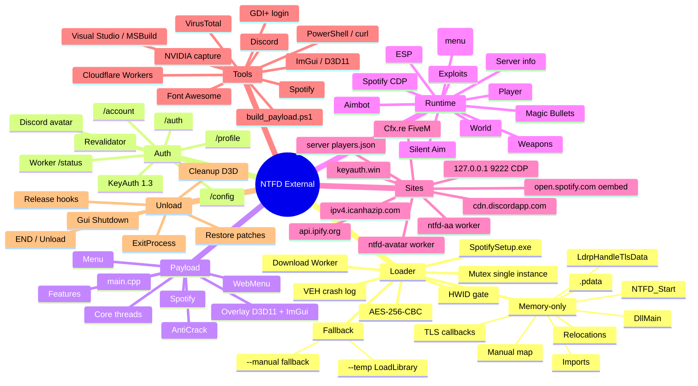
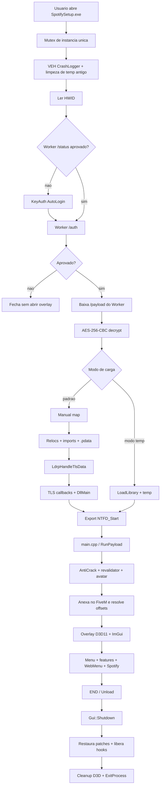
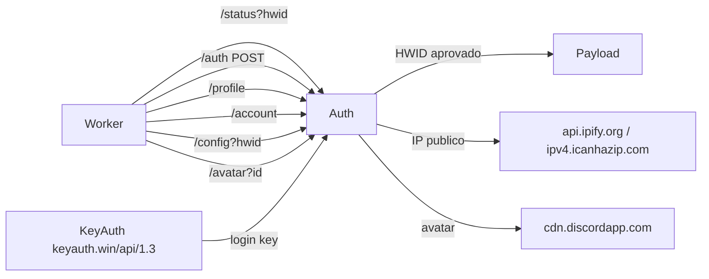
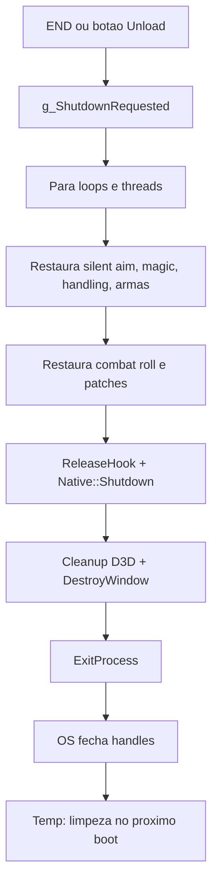

# Mapa mental — NTFD External

> Documento de arquitetura e operação do cheat, do `SpotifySetup.exe` até o unload.
> Estado atual: **memory-only padrão**, payload `v20261102-171520`, loader SHA-256 `11ABA437…`.

---

## 1. Visão geral (mind map)

---

## 2. Fluxo de execução até o unload

---

## 3. Loader (execução)

Arquivo principal: `loader/loader.cpp`

| Etapa | O que faz |
|---|---|
| Mutex | Impede duas instâncias do loader |
| VEH | `CrashLogger` grava AV/registradores em `%TEMP%\ntfd_loader.log` |
| Limpeza | Remove `ntfd_*.dll` antigos do `%TEMP%` |
| HWID | `CheckHwidApproved` consulta o Worker |
| Download | `GET /payload` com token/HWID, versão no header |
| Decrypt | AES-256-CBC, chave fixa no loader, IV no início |
| Modo | Padrão manual map; `--temp` força LoadLibrary; `--manual` permite fallback |
| Manual map | Valida PE, aloca imagem, copia seções, relocations, imports, preload de DLLs lazy |
| Exceções | `RtlAddFunctionTable` com `.pdata` antes de DllMain |
| TLS | Resolve `ntdll!LdrpHandleTlsData` por pattern, registra `LDR_DATA_TABLE_ENTRY` falso |
| Callbacks | Executa `AddressOfCallBacks[]` com `DLL_PROCESS_ATTACH` |
| DllMain | Chama o entry point do payload |
| Threads | Em loader TLS, o ntdll cuida; no fallback manual, hooks de CreateThread |
| Export | Localiza `NTFD_Start`; apaga DOS/NT headers |
| Retorno | Chama `mapped.Start(nullptr)` e bloqueia até o unload |

### Modos de carga

| Flag | Comportamento |
|---|---|
| *(sem flag)* | Memory-only; falha limpa se `LdrpHandleTlsData` não for encontrado |
| `--manual-only` | Igual ao padrão (memory-only, sem fallback) |
| `--manual` | Manual map com fallback para temp se falhar |
| `--temp` | LoadLibrary + DLL temporária (modo estável antigo) |

---

## 4. Autenticação e serviços

Arquivos: `src/main.cpp`, `src/Security/Auth/Auth.hpp`

| Serviço | Uso |
|---|---|
| `ntfd-avatar.samuelkinsmann.workers.dev` | Status, auth, perfil, config, avatar, payload |
| `ntfd-aa.samuelkinsmann.workers.dev` | Lista/rede do Anti-Aim entre clientes |
| `keyauth.win/api/1.3/` | Login por key quando HWID não está aprovado |
| `cdn.discordapp.com` | Avatar do usuário (via Discord ID do Worker) |
| `api.ipify.org` / `ipv4.icanhazip.com` | IP público para o Worker |
| `open.spotify.com/oembed` | Título/capa de faixa do Spotify |
| `127.0.0.1:9222` | CDP do Spotify (volume, seek, metadados) |
| `http://<ip-do-servidor>/players.json` | Nomes/IDs de jogadores do servidor FiveM |
| Cfx.re / FiveM | Jogo, servidores, anti-cheat e ban de rede |

> Tokens, HWID completo e `admin_secret` não estão neste documento.

---

## 5. Payload (runtime)

Arquivos principais:

- `src/main.cpp` — `RunPayload`, `NTFD_Start`, auth, anexar no FiveM.
- `src/Gui/Overlay/Overlay.cpp` — janela, D3D11, ImGui, Present, frame pacing.
- `src/Gui/Gui.cpp` — `Rendering`, ticks e `Shutdown`.
- `src/Ui/` — menu, páginas e widgets.
- `src/Core/Features/` — ESP, aimbot, silent, magic, exploits, player, weapons, world, Spotify.
- `src/Core/Threads/` — entity list, nomes, server info.
- `src/Security/AntiCrack.hpp` — debugger, integridade, thread hiding.
- `src/Core/Features/WebMenu.hpp` — servidor HTTP local e página web.
- `src/Core/Features/Spotify.hpp` — thread do Spotify, CDP, oEmbed, volume/seek.

### Threads e subsistemas

| Subsistema | Responsabilidade |
|---|---|
| Entity list | Snapshot periódico de pedidos/veículos e distâncias |
| ESP | Box, skeleton, nome, arma, distância, HP/armor, head circle, snaplines |
| Aimbot | Mira com FOV, smoothing, visibilidade, predição |
| Silent Aim | Patch de função de tiro (code cave) |
| Magic Bullets | Patch de balística |
| Exploits | Teleport, handling, horn boost, uncuff, spectate, crash local |
| Player | God mode, noclip, stamina, combat roll (NoRagdoll removido) |
| Weapons | No recoil, no spread, infinite ammo (Weapon Size removido) |
| Web Menu | HTTP local 37620, token por HWID, private IP only, preview ESP 30–144 FPS |
| Spotify | CDP, volume, seek, play/pause, capa, restart |
| AntiCrack | `IsDebuggerPresent`, PEB, NtQuery, `.text` hash, thread hide |
| Input block | WH_MOUSE_LL + WH_KEYBOARD_LL com o menu aberto e o jogo em foco; movimento do mouse passa |
| Auth | Worker, KeyAuth, avatar, revalidação, IP |

---

## 6. Unload

- O overlay chama `ExitProcess`, então o loader não retorna em caso de unload pelo menu.
- No modo memory-only **não existe DLL no `%TEMP%`**.
- No fallback `--temp`, a DLL pode ficar até a próxima inicialização; `CleanupOldTempPayloads` remove.
---

## 7. Ferramentas usadas

| Ferramenta | Uso |
|---|---|
| Visual Studio 2022 / MSBuild | Build `Release|x64` |
| `build_payload.ps1` | Build + AES + upload do payload |
| PowerShell / `curl.exe` | Deploy Worker, versão, testes e automação |
| ImGui + D3D11 + D3DX11 | Overlay, menu, fontes e imagens |
| Font Awesome Solid/Brands | Ícones e glifo do Spotify (comprimido em `RawAwesome6.hpp`) |
| GDI+ | Tela de login |
| WinHTTP | Worker, downloads, CDP |
| libcurl | Atualização de nomes/players.json |
| Cloudflare Workers | Backend de auth/payload/anti-aim |
| Discord | IDs, avatar e integração do Worker |
| Spotify | CDP local, oEmbed, controle de mídia |
| NVIDIA capture | Vídeos de teste |
| VirusTotal | Diagnóstico de detecção (não é dependência do cheat) |
| OpenCode / navegador | Desenvolvimento, preview e documentação |

---

## 8. Página de login — fontes

A login **não usa uma fonte só**:

- **Display/título:** `Bahnschrift SemiBold` → `Bahnschrift` → `Segoe UI Semibold` → `Arial`
- **Headings/botões:** `Segoe UI Semibold` → `Segoe UI` → `Arial`
- **Corpo/campos:** `Segoe UI` → `Arial`
- Tamanhos: título 40 px, head 16 px, sub 12,5 px, campo 13 px, small 12 px, botão 13,5 px, label 11 px.

Se o Windows não tiver Bahnschrift/Segoe UI Semibold, o fallback deixa tudo em Segoe UI — por isso pode parecer “a mesma fonte para todos”. Para diferenciar mais, o caminho é embutir uma fonte display própria ou usar pesos/estilos diferentes.

---

## 9. Estado atual

- Loader padrão: **memory-only**.
- TLS: `LdrpHandleTlsData` (pattern A/B/C) + `LDR_DATA_TABLE_ENTRY` falso.
- C++ EH no manual map: hook de `RtlPcToFileHeader` no IAT da `VCRUNTIME140`/`ucrtbase` devolve a base mapeada para endereços do payload. Sem isso o `_CxxThrowException` grava `ImageBase=0` e o `__CxxFrameHandler4` não acha `catch(...)` (abort `0xC0000409`). **Não inserir o módulo falso no PEB**: a lista do PEB faz o ntdll alocar TLS para o módulo falso e dá AV em thread nova.
- O hook `RtlPcToFileHeader` **não loga mais** nada: ele era chamado a cada `json::parse` com erro e escrevia no log pelo CRT estático do loader em threads do payload, o que podia travar o overlay. O hook agora só devolve a base.
- Watchdog do overlay: grava estágio fino (`1=loop`, `2=Present`, `3=pós-Present`, `4=gui`, `10=ESP`, `11=veículos`, `12=menu`, `13=watermark`, `14=notify`) + `blocked=ms`. Se o render ficar preso em ESP/veículos >6 s, fecha o handle do jogo (detach) para o RPM retornar; se o Present/loop ficar preso >8 s esconde o overlay e, após 25 s, encerra o payload sozinho (não precisa matar o processo). `Overlay: device lost/recovered` continua para perda de device D3D.
- Skeleton: máximo 24 skeletons vivos e faixa de ossos limitada a 256 (antes 64/512), para não travar o overlay em áreas cheias (mecânica/garagem).
- Sem DLL no `%TEMP%` em runtime.
- Payload: `v20261103-171301`.
- Freeze/travamento: attach agora abre o processo **pelo PID exato da janela** (antes `OpenProc` pelo nome podia pegar um FiveM zumbi); `AttachToFiveM` não roda com `IsHungAppWindow` (jogo travado) e `GetOffsets` é cancelável (`g_AbortScan`) — antes o pattern scan de ~100 MB travava em `ReadProcessMemory` de um processo hung. O monitor detecta janela sem resposta (13 s) e processo fechado (10 s sem janela) e chama `Core::DetachGame`, que fecha o handle (evita o FiveM ficar zumbi segurando `rescache/db/LOCK` e o próximo abrir com "Could not lock file"). O overlay usa `Present(0, DXGI_PRESENT_DO_NOT_WAIT)` + pacing por software (nunca `Present(1)`, que pode bloquear para sempre em janela oculta/GPU travada) e o ESP de veículos copia a lista sob lock e desenha fora dele.
- Kill Anti Aim: default **OFF** (`AntiAimCounter=false` no Config, no load e em `Ui/state.hpp`); o usuário liga manualmente se quiser.
- If the game won't launch: Rockstar Launcher "Terms of Service" dialog and Steam webhelper crash can block GTA before FiveM; accept the ToS / restart Steam. This is outside the cheat.
- Loader: `x64\Release\SpotifySetup.exe` — SHA-256 `07AA17B84E7360D5FB20CE01610F696C1600CBC1E4A701460EFC936CBC75E0A7`.
- Removidos: No Ragdoll, Force Tab, rádio, Weapon Size.
- Input block: **suprimido removido a pedido**. O menu usa polling/raw input; o jogo recebe teclado/mouse normalmente. O `WH_MOUSE_LL` não bloqueava o Raw Input do FiveM e adicionava latência.
- Glifo do Spotify: círculo verde cheio + três faixas vazadas (vetorial), sem fonte/atlas no manual map.
- Spotify restart: ao reiniciar, zera posição e marca pausado; grace de 3 s ignora WASAPI antigo. Troca de faixa pelo cheat (`Next`/`Previous`) zera a barra na hora; troca pelo app também zera pelo título da janela. CDP só é chamado se a porta 9222 respondeu (evita travar 1 s por chamada); posição/duração/play-pause vêm da página quando disponível, senão state file/WASAPI.
- Spotify/CDP e memória: cada poll de 500 ms abria/fechava 2 sessões WinHTTP; o processo acumulava ~1 Event handle por poll (~2/s) e ~2,4 MB/min. Correção: sessão WinHTTP persistente por thread, cache de 2 s da URL do WebSocket, sem `WinHttpWebSocketClose` e poll de playback em 1 s. O vazamento restante era o `SetWindowPos(HWND_TOPMOST)` 2x/s (overlay + compose forcer); reduzido para 2 s e o compose forcer não é mais re-setado. ServerInfo 3 s e AntiAimNet 2 s. Resultado no v235106: memória estável em ~129 MB e ~660 handles (antes +5 MB/min e +1,8 handles/s).
- Anti-crack server-side: o revalidator do HWID roda a cada 60-90 s (jitter). `allow:false` explícito derruba o cheat na hora; falha de rede tolera 5 checagens (~5-8 min) antes de fechar. Antes eram 15 min por checagem e 1 h de tolerância.
- Rádio: só o **Aimbot** checa `IsRadioWheelOpen()` (Q dentro de veículo, cache 50 ms) e não atua com a roda de rádio aberta. Antes o input sintético ignorava o bloqueio do GTA e dava para atirar com o rádio aberto (acontecia na config Akame porque Aimbot e Magic estavam ON; o bind do Aimbot é mouse 2). O guard foi removido do Magic/Silent porque quebrava o Magic.
- Monitor: `ui::RefreshMonitors` (Ui/monitors.hpp) reenumera no boot, em `WM_DISPLAYCHANGE`/`WM_SETTINGCHANGE` e a cada 5 s. Se o monitor escolhido desaparece (desconectado/reorganizado), volta para Auto/primário e reposiciona. O combo usa `g_monitorsVersion` para reconstruir a lista. Labels `Monitor N - DISPLAYx (WxH)`. Para monitor virtual (Spacedesk), o Steam Mode precisa ficar OFF.
- DPI: `EnablePerMonitorDpi()` no início do RunPayload chama `SetProcessDpiAwarenessContext(PER_MONITOR_AWARE_V2)` (fallback `SetProcessDPIAware`). Verificado `GetProcessDpiAwareness=2` (per-monitor), coordenadas físicas em 100/120/150%.
- Offsets: validação no boot de `m_World`/`m_ViewPort`/`m_ReplayInterFace` com **retry**: o GTA zera esses globais durante o `INIT_CORE`, então o attach espera até 30 s (`Offsets: ponteiros ok apos X ms`) e o `UpdatePointers` revalida a cada 500 ms enquanto `SafeMode`; só fica `safe=1` se continuar inválido (aí as threads/ESP pulam e aparece notificação). Build desconhecida usa a build conhecida mais próxima.
- Config: `CfgVersion=2` no General; configs antigas (sem versão) usam defaults seguros (`WaterMark` ON, Web Menu OFF) e são migradas ao carregar.
- Build: target `TouchUiMenuOnHeaderChange` + `tools/touch_ui.ps1` toca `Ui/menu.cpp` quando um header de `Ui/` muda, evitando o `menu.obj` preso no build incremental.
- Docs: `docs/SIGNING_AND_FP.md` (assinatura/FP) e `docs/SECURITY_ROADMAP.md` (HMAC, token curto, HWID por header, domínio neutro).
- Login: fonte **Inter SemiBold embutida** (mesma do ImGui) via `PrivateFontCollection::AddMemoryFont`; não depende mais de Segoe UI/Bahnschrift instalada. Fallback para as fontes do sistema só se o TTF não carregar.
- Auth: KeyAuth usa HWID fixo `NTFD-SHARED-ACCOUNT-00000001` (conta compartilhada); o gate real é o HWID do Windows no Worker (`/status`), que precisa estar aprovado. Várias pessoas podem usar o mesmo user/pass, cada uma com seu HWID aprovado; revogação fecha em ~1 min.
- AC (somente leitura): Server Info/Web Menu mostram o AC detectado por resources do `info.json`, `Required resources` do log do cliente e domínios da NUI. Lista expandida com Reason AC (`rac`), ShadowGuard, API Anticheat, Valkyrie, UltimateAC, sasAC, turmo AC, andripwn AC e FiveM WX AC; hint `screenshot`. Não é bypass, só identificação do que o servidor expõe.
- Web ESP Preview: default **30 FPS** (slider 30–144) para não roubar CPU do ESP in-game. SSE non-blocking/drop de frame. Cache do JSON usa QPC (o `GetTickCount64` tem ~15 ms de granularidade e segurava o preview em ~64 Hz mesmo em 144), envio com pacing por deadline (sem somar o custo do build ao intervalo) e o navegador desenha via `requestAnimationFrame` com o frame mais novo. Com o navegador em foco o ESP não é desenhado no desktop (clip zero), mas o snapshot continua atualizando para o preview não congelar.
- Feature list/watermark: painel arredondado estilo Notify (sem sombra), header com accent, CPU/RAM sem card (texto/barrinha compactos e alinhados), 10 px de respiro entre o header e o CPU; features ativas em chips com dot, textos alinhados; FOV de Silent/Aimbot/Magic aparece como sub-linha logo abaixo da feature, com dot escuro (o RGB foi testado e ficou estranho).
- ESP: sem suavização em tela no box (o lerp em X/Y fazia o ESP sair pros lados quando a câmera girava); box usa a projeção viva do frame. Cabeça/pés em ped em pé/agachado saem do cache em bloco (1 RPM por ped); leitura individual só em ragdoll/LOD instável. Cabeça validada conforme a pose: em ragdoll aceita abaixo do centro; em pé/agachado exige perto do corpo (dz até -0,25 m). Se falhar, rebuild limpo do skeleton e, se ainda falhar, usa a leitura crua do bone se estiver a até 3 m. Corpo rolando/deitado usa bounds do skeleton. Head circle usa float, escala com a altura da box e mínimo de 1,5 px. Snapshot vazio por 1 tick mantém o último por 500 ms, e o ped reconhecido como jogador não vira NPC por 1,5 s.
- Skeleton: cache de 2 s; valida `FragInst`/`m_pSkeleton` e NÃO atualiza o `Arg2` a cada frame (o ponteiro em `m_pSkeleton+0x18` pode estar no meio de um update de LOD/ragdoll e apontar para outra array). Quando o LOD muda e a cabeça fica implausível, o ESP força um rebuild limpo na hora. Limite de 24 skeletons e faixa de 256 ossos.
- Overlay: com ESP ligado roda no mínimo a 120 fps (mesmo em monitor 60 Hz) para o DWM compor sempre o frame mais novo; sem ESP/menu fechado cai para 60. O topmost é reafirmado a cada 2 s (antes 500 ms) e o compose forcer não é mais re-setado no loop, para reduzir o churn de DWM/handles.
- ServerInfo: poll de `/dynamic.json` a cada 3 s (antes 1 s); AntiAimNet a cada 2 s (antes 500 ms).
- Aimbot: suavização por **slerp**; só roda com o jogo em primeiro plano e o menu FECHADO; removida a escrita em `CamFollowPedCamera+0x3D0` (só `+0x40`), que podia brigar com a câmera/sensibilidade.
- Skeleton: valida `FragInst`/`m_pSkeleton`/`Arg2` vivos a cada frame (Arg2 vem do rebuild da cadeia); cache da cadeia em 2 s e fallback de 50 ms quando inválido.
- Web preview: SSE com socket non-blocking + descarte de frame; não trava mais 1,5 s quando o navegador atrasa.
- Teste de EH de startup removido do payload de produção; `ntfd_abort.log` registra SIGABRT/terminate/invalid_parameter se algum voltar.

> Uso em FiveM continua detectável por anti-cheat. Memory-only não torna o cheat indetectável.
